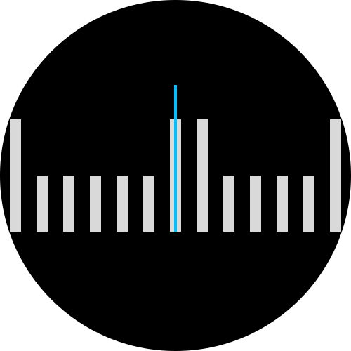

<p align="center">
  
</p>

<h1 align="center">react-native-ruler-date-picker</h1>

<p align="center">
  A performant, customizable horizontal ruler date picker & scroll wheel for React Native and Expo. Powered by 60 FPS Reanimated 3 physics and dual-speed haptic feedback.
</p>

<p align="center">
  <a href="https://github.com/md-rehman/react-native-ruler-date-picker"><strong>Documentation & Interactive Demos »</strong></a>
  &nbsp;•&nbsp;
  <a href="https://snack.expo.dev/ml8FWVY75Lzz1xkxUkTV6"><strong>Try Live Snack on Phone 📱 »</strong></a>
</p>

## 📱 Interactive Live Demo

Experience 60 FPS physics and feel the real physical taptic feedback on your device with our live Expo Snack:

[](https://snack.expo.dev/ml8FWVY75Lzz1xkxUkTV6)

> **Test on Real Device**:
> 1. Open the [Kitchensink Snack](https://snack.expo.dev/ml8FWVY75Lzz1xkxUkTV6).
> 2. Select the **"My Device"** tab to reveal the QR code.
> 3. **iOS**: Scan with your Camera app and tap **"Open in Expo Go"**.  
>    **Android**: Open **Expo Go** and scan the QR code.

## ✨ Features

- **60 FPS Physics** — Reanimated 3 decay animations with snap-to-tick alignment
- **Dual-Speed Haptics** — Discrete ticks at slow scroll, continuous buzz at fast swipe
- **Windowed Rendering** — Only renders visible ticks + buffer for memory efficiency
- **Multi-Tier Rule-Based Graduations** — Declarative tick rules (`ticks="calendar"` | `"metric"` | `"minimal"` or custom rules array)
- **Compound Anatomy API** — Full layout flexibility with `Ruler.*` and `RulerRange.*`
- **Date Range Selection [Experimental]** — Dual-handle date range picker with `RulerDateRangePicker`
- **Dark Mode Support** — Auto-detects system color scheme with custom theme palette override

## 📦 Installation

```bash
npm install react-native-ruler-date-picker
# or
yarn add react-native-ruler-date-picker
# or
pnpm add react-native-ruler-date-picker
```

### Peer Dependencies

Make sure you have these installed in your project:

```bash
npm install react-native-reanimated react-native-gesture-handler
```

Optional (for haptic feedback):

```bash
npx expo install expo-haptics
```

### Configure Peer Dependencies

#### 1. Babel Configuration
For bare React Native CLI apps, add the Reanimated Babel plugin to your `babel.config.js` as the **very last** plugin:

```javascript
module.exports = {
  presets: ['module:@react-native/babel-preset'],
  plugins: [
    'react-native-reanimated/plugin', // MUST be last plugin
  ],
};
```

> **Note for Expo (SDK 50+)**: In managed Expo workflows using `babel-preset-expo`, the Reanimated Babel plugin is included automatically.

#### 2. GestureHandlerRootView
Wrap your application root component with `GestureHandlerRootView` so gestures and pan physics function properly:

```tsx
import React from 'react';
import { GestureHandlerRootView } from 'react-native-gesture-handler';
import MainScreen from './MainScreen';

export default function App() {
  return (
    <GestureHandlerRootView style={{ flex: 1 }}>
      <MainScreen />
    </GestureHandlerRootView>
  );
}
```

> If using **Expo Router**, wrap your root layout in `app/_layout.tsx`.

## 🚀 Quick Start

```tsx
import React, { useState } from 'react';
import { View, Text, StyleSheet } from 'react-native';
import { RulerDatePicker } from 'react-native-ruler-date-picker';

export default function App() {
  const [date, setDate] = useState(new Date());

  return (
    <View style={styles.container}>
      <Text style={styles.label}>
        Selected: {date.toLocaleDateString('en-US', { month: 'short', day: 'numeric', year: 'numeric' })}
      </Text>

      <RulerDatePicker
        value={date}
        onChange={(newDate, dateString) => {
          setDate(newDate);
          console.log('Selected Date:', dateString); // "YYYY-MM-DD"
        }}
        ticks="calendar"
        header={{ showResetToToday: true }}
      />
    </View>
  );
}

const styles = StyleSheet.create({
  container: {
    flex: 1,
    justifyContent: 'center',
    alignItems: 'center',
    backgroundColor: '#0F172A',
  },
  label: {
    color: '#F8FAFC',
    fontSize: 16,
    fontWeight: '600',
    marginBottom: 24,
  },
});
```

## 📅 Date Range Selection [Experimental]

Select a range with start and end handles using `RulerDateRangePicker`:

```tsx
import React, { useState } from 'react';
import { View, StyleSheet } from 'react-native';
import { RulerDateRangePicker, DateRange } from 'react-native-ruler-date-picker';

export default function RangeBookingScreen() {
  const [range, setRange] = useState<DateRange>({
    start: new Date(),
    end: new Date(Date.now() + 5 * 86400000), // +5 days
  });

  return (
    <View style={styles.container}>
      <RulerDateRangePicker
        value={range}
        onChange={({ startDate, endDate, dateRange }) => {
          setRange(dateRange);
          console.log('Selected range:', startDate, '→', endDate);
        }}
        minSpanDays={1}
        maxSpanDays={30}
      />
    </View>
  );
}

const styles = StyleSheet.create({
  container: {
    flex: 1,
    justifyContent: 'center',
    alignItems: 'center',
    backgroundColor: '#0F172A',
  },
});
```

## 🧩 Compound Anatomy API

For full layout flexibility, compose custom pickers with `Ruler.*`:

```tsx
import React, { useState } from 'react';
import { View } from 'react-native';
import { Ruler } from 'react-native-ruler-date-picker';

export default function CustomAnatomy() {
  const [date, setDate] = useState(new Date());

  return (
    <Ruler.Root value={date} onChange={setDate} tickSpacing={28}>
      {/* 1. Header with custom placement */}
      <Ruler.Header showResetToToday={false} />

      {/* 2. Scroll arena containing needle & graduation ticks */}
      <Ruler.Track>
        <Ruler.Indicator />
        <Ruler.Ticks />
      </Ruler.Track>

      {/* 3. Standalone Reset button */}
      <View style={{ alignItems: 'center', marginTop: 12 }}>
        <Ruler.ResetButton label="Jump to Today" />
      </View>
    </Ruler.Root>
  );
}
```

For range pickers, use `RulerRange.*` (`RulerRange.Root`, `RulerRange.Header`, `RulerRange.Track`, `RulerRange.Ticks`, and `RulerRange.Indicator`).

## 📐 API Reference

### Props

| Prop | Type | Default | Description |
|---|---|---|---|
| `value` | `Date \| string` | `new Date() (Today)` | Currently selected date (controlled). Accepts Date or "YYYY-MM-DD". |
| `defaultValue` | `Date \| string` | `new Date() (Today)` | Initial selected date for uncontrolled mode. |
| `onChange` | `(date: Date, dateString: string) => void` | `undefined` | Called when scrolling stops and snaps to a date. |
| `minDate` | `Date \| string` | `Today - 365 days` | Minimum selectable date boundary. |
| `maxDate` | `Date \| string` | `Today + 365 days` | Maximum selectable date boundary. |
| `locale` | `string` | `'default'` | BCP 47 locale tag (e.g. "en-US", "de-DE", "ja-JP") for date formatting. |
| `ticks` | `TickRule[] \| 'calendar' \| 'metric' \| 'minimal'` | `'calendar'` | Graduation rules array or preset name. |
| `tickSpacing` | `number` | `24` | Gap in pixels between consecutive tick graduation marks. |
| `tickWidth` | `number` | `3` | Base thickness in pixels for tick graduation bars. |
| `width` | `number` | `window width` | Viewport track width in pixels. Defaults to device window width. |
| `rulerHeight` | `number` | `60` | Height in pixels of the interactive ruler tick viewport track. |
| `header` | `boolean \| HeaderConfig` | `true` | Top date header display, config options, or custom renderer. |
| `indicator` | `boolean \| IndicatorConfig` | `true` | Center needle indicator display, dimensions, or custom renderer. |
| `haptics` | `boolean \| HapticConfig` | `true` | Dual-speed tactile vibration toggle or custom trigger callback. |
| `lensEffect` | `boolean \| LensConfig` | `false` | Optical fisheye lens distortion magnifying center spacing. |
| `theme` | `RulerTheme` | `auto (system)` | Color theme tokens overriding default Light/Dark color scheme. |
| `style` | `StyleProp<ViewStyle>` | `undefined` | Container view style applied to outer root component. |
| `debounceMs` | `number` | `100` | Debounce duration in milliseconds for `onChange` during fast scroll. |
| `testID` | `string` | `undefined` | Identifier for automated testing and inspection. |
| `accessibilityLabel` | `string` | `'Date picker'` | Screen reader accessibility label for assistive technologies. |

## 🎨 Theming

Colors auto-detect system light/dark mode. Provide custom tokens using `theme`:

```tsx
<RulerDatePicker
  value={date}
  onChange={setDate}
  theme={{
    background: '#0F172A',
    indicatorColor: '#38BDF8',
    accentColor: '#38BDF8',
    labelColor: '#F8FAFC',
    defaultTickColor: '#334155',
  }}
/>
```

## 📄 License

MIT © [Rehman](https://md-rehman.dev)