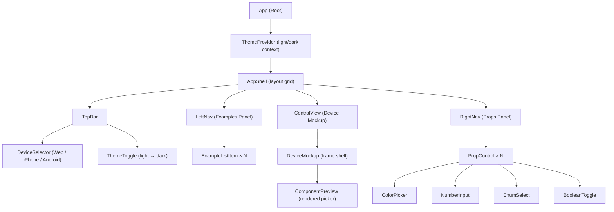
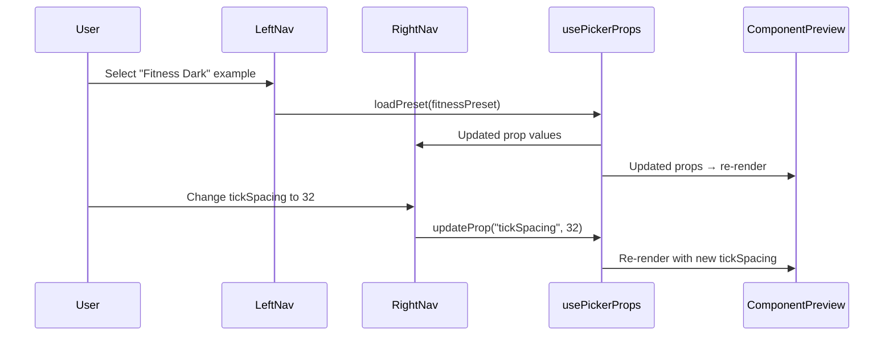

# 🎯 Implementation Plan — `apps/demo` Interactive Playground

> An interactive SPA playground for `react-native-ruler-date-picker` with device mockups, translucent panels, live prop editing, and light/dark mode.

---

## 1. High-Level Architecture



---

## 2. Technology Choice

| Concern | Decision | Rationale |
|---|---|---|
| **Framework** | **Next.js + React + TypeScript** | React framework with App Router as requested, capable of SPA/SSG. |
| **Styling** | **Vanilla CSS** with CSS custom properties | Full control, no Tailwind — as per workspace rules |
| **State management** | React `useState` + Context | Small enough scope, no external lib needed |
| **Component rendering** | **`react-native-web`** | Renders the RN picker natively in browser as a web component |
| **Monorepo integration** | New workspace member at `apps/demo` | Consistent with existing `apps/*` pattern |

---

## 3. Folder Structure

```
apps/demo/
├── package.json
├── tsconfig.json
├── next.config.mjs
├── app/
│   ├── layout.tsx                  # Root layout
│   ├── page.tsx                    # Main page component
│   ├── globals.css                 # Global styles & CSS variables
│   │
│   ├── context/
│   │   └── ThemeContext.tsx         # Light/Dark mode context
│   │
│   ├── hooks/
│   │   └── usePickerProps.ts       # Manages current prop values state
│   │
│   ├── data/
│   │   ├── propDefinitions.ts      # Prop metadata (type, default, enum values, etc.)
│   │   └── examples.ts             # Predefined example presets
│   │
│   ├── components/
│   │   ├── AppShell/
│   │   │   ├── AppShell.tsx        # Main layout grid
│   │   │   └── AppShell.module.css
│   │   │
│   │   ├── TopBar/
│   │   │   ├── TopBar.tsx          # Device selector + theme toggle
│   │   │   └── TopBar.module.css
│   │   │
│   │   ├── DeviceSelector/
│   │   │   ├── DeviceSelector.tsx  # Web / iPhone / Android buttons
│   │   │   └── DeviceSelector.module.css
│   │   │
│   │   ├── ThemeToggle/
│   │   │   ├── ThemeToggle.tsx     # Sun/Moon toggle button
│   │   │   └── ThemeToggle.module.css
│   │   │
│   │   ├── LeftNav/
│   │   │   ├── LeftNav.tsx         # Examples panel (collapsible)
│   │   │   └── LeftNav.module.css
│   │   │
│   │   ├── ExampleListItem/
│   │   │   ├── ExampleListItem.tsx # Single example entry
│   │   │   └── ExampleListItem.module.css
│   │   │
│   │   ├── CentralView/
│   │   │   ├── CentralView.tsx     # Device mockup container
│   │   │   └── CentralView.module.css
│   │   │
│   │   ├── DeviceMockup/
│   │   │   ├── DeviceMockup.tsx    # iPhone/Android/Web frame shells
│   │   │   └── DeviceMockup.module.css
│   │   │
│   │   ├── ComponentPreview/
│   │   │   ├── ComponentPreview.tsx # Renders RulerDatePicker with current props
│   │   │   └── ComponentPreview.module.css
│   │   │
│   │   ├── RightNav/
│   │   │   ├── RightNav.tsx        # Props editor panel (collapsible)
│   │   │   └── RightNav.module.css
│   │   │
│   │   └── PropControl/
│   │       ├── PropControl.tsx     # Router component → dispatches to correct input
│   │       ├── PropControl.module.css
│   │       ├── ColorPicker.tsx     # Native color input
│   │       ├── NumberInput.tsx     # Number text input with stepper
│   │       ├── EnumSelect.tsx      # Dropdown select
│   │       └── BooleanToggle.tsx   # Toggle switch
│   │
│   └── styles/
│       └── glass.css               # Reusable translucent/liquid-glass utility classes
```

---

## 4. CSS Variable Design System

All colors, dimensions, and glass effects defined as CSS custom properties on `:root` and `[data-theme="dark"]`:

```css
:root {
  /* ── Surface ── */
  --color-bg:             #F5F5F7;
  --color-surface:        rgba(255, 255, 255, 0.6);
  --color-surface-hover:  rgba(255, 255, 255, 0.8);

  /* ── Text ── */
  --color-text-primary:   #1D1D1F;
  --color-text-secondary: #6E6E73;
  --color-text-muted:     #AEAEB2;

  /* ── Accent ── */
  --color-accent:         #007AFF;
  --color-accent-hover:   #0056CC;

  /* ── Glass Effect ── */
  --glass-bg:             rgba(255, 255, 255, 0.45);
  --glass-border:         rgba(255, 255, 255, 0.25);
  --glass-blur:           20px;
  --glass-shadow:         0 8px 32px rgba(0, 0, 0, 0.08);

  /* ── Spacing ── */
  --spacing-xs:  4px;
  --spacing-sm:  8px;
  --spacing-md:  16px;
  --spacing-lg:  24px;
  --spacing-xl:  32px;

  /* ── Radius ── */
  --radius-sm:   8px;
  --radius-md:   12px;
  --radius-lg:   16px;
  --radius-xl:   24px;

  /* ── Nav ── */
  --nav-width:           280px;
  --topbar-height:       56px;

  /* ── Transitions ── */
  --transition-fast:     150ms ease;
  --transition-normal:   250ms ease;
  --transition-slow:     400ms ease;
}

[data-theme="dark"] {
  --color-bg:             #1C1C1E;
  --color-surface:        rgba(44, 44, 46, 0.6);
  --color-surface-hover:  rgba(44, 44, 46, 0.8);
  --color-text-primary:   #F5F5F7;
  --color-text-secondary: #A1A1A6;
  --color-text-muted:     #636366;
  --color-accent:         #0A84FF;
  --color-accent-hover:   #409CFF;
  --glass-bg:             rgba(44, 44, 46, 0.55);
  --glass-border:         rgba(255, 255, 255, 0.08);
  --glass-shadow:         0 8px 32px rgba(0, 0, 0, 0.3);
}
```

---

## 5. Component Details

### 5.1 — `ThemeContext`
- Provides `theme` (`'light' | 'dark'`) and `toggleTheme()`
- Sets `data-theme` attribute on `<html>` for CSS variable switching
- Defaults to system preference via `prefers-color-scheme`

### 5.2 — `TopBar`
- Fixed position top
- Contains `DeviceSelector` (centered) + `ThemeToggle` (right-aligned)
- Translucent glass effect

### 5.3 — `DeviceSelector`
- 3 segmented buttons: **Web** (monitor icon), **iPhone** (Apple icon), **Android** (robot icon)
- Only one active at a time; pill-style active indicator
- Updating selection changes which `DeviceMockup` frame renders

### 5.4 — `LeftNav` (Examples Panel)
- Translucent glass panel, fixed left
- Collapsible: slides off-screen left with a toggle handle
- Lists predefined examples from `data/examples.ts`
- Selecting an example resets all prop values to that example's preset

### 5.5 — `RightNav` (Props Panel)
- Translucent glass panel, fixed right
- Collapsible: slides off-screen right with a toggle handle
- Scrollable list of `PropControl` components
- Organized by sections from `types.ts` comments (Selection, Tick Dimensions, Colors, Layout, etc.)

### 5.6 — `PropControl`
A smart router component. Based on prop metadata:

| Prop Type | Control Rendered | Example Props |
|---|---|---|
| `string` (color) | `ColorPicker` — native `<input type="color">` + hex display | `tickColor`, `accentColor`, `backgroundColor` |
| `number` | `NumberInput` — `<input type="number">` with min/max/step | `tickSpacing`, `height`, `bufferTicks` |
| `boolean` | `BooleanToggle` — CSS toggle switch | `enableHaptics`, `showResetToToday` |
| `enum` (string union) | `EnumSelect` — `<select>` dropdown | `labelInterval` (`daily\|weekly\|monthly`) |
| `function` / `Date` / `ReactNode` | **Not editable** — displayed as read-only label | `onSelectDate`, `renderHeader` |

### 5.7 — `DeviceMockup`
Pure CSS device frames:

| Device | Visual Frame |
|---|---|
| **Web** | Browser chrome with dots + address bar, 16:10 aspect |
| **iPhone** | iPhone 15 silhouette with dynamic island notch, 9:19.5 aspect |
| **Android** | Pixel-style rounded rect with punch-hole camera, 9:20 aspect |

The component only renders the frame. The child `<ComponentPreview>` renders inside it.

### 5.8 — `ComponentPreview`
- Uses `react-native-web` to render `<RulerDatePicker>` with current prop values
- Wrapped in a `<GestureHandlerRootView>` (from `react-native-gesture-handler`)
- Receives props from the central state managed by `usePickerProps`

### 5.9 — `CentralView`
- Flex-centered container between left/right navs
- Contains `DeviceMockup` > `ComponentPreview`
- Subtle background dot-grid or gradient

---

## 6. Predefined Examples (`data/examples.ts`)

Each example is a named partial prop override object:

| Example Name | Description |
|---|---|
| **Default** | All defaults — clean baseline |
| **Fitness Dark** | Neon cyan/purple on dark slate (from kitchensink) |
| **Event Scheduler** | Blue accent on white, bounded ±30/60 days |
| **Sunset Warm** | Orange/red warm palette |
| **Compact** | Smaller ticks, tight spacing |
| **Wide Spacing** | Larger ticks, wide spacing |
| **Monthly Labels** | Monthly label interval only |
| **No Haptics** | Haptics disabled |

---

## 7. Data Flow



---

## 8. Glass / Translucent Effect

Applied to `TopBar`, `LeftNav`, and `RightNav` via shared `.glass` CSS class:

```css
.glass {
  background: var(--glass-bg);
  backdrop-filter: blur(var(--glass-blur));
  -webkit-backdrop-filter: blur(var(--glass-blur));
  border: 1px solid var(--glass-border);
  box-shadow: var(--glass-shadow);
}
```

---

## 9. Responsive Considerations
- **Desktop (≥1024px):** Full 3-column layout with both navs visible
- **Tablet (768–1023px):** Both navs collapsed by default, toggle to overlay
- **Mobile (< 768px):** Navs become slide-over drawers; device mockup scales down

---

## 10. Next.js Configuration Highlights

```js
// next.config.mjs
/** @type {import('next').NextConfig} */
const nextConfig = {
  transpilePackages: [
    'react-native-reanimated',
    'react-native-gesture-handler',
    'react-native-ruler-date-picker'
  ],
  webpack: (config) => {
    config.resolve.alias = {
      ...(config.resolve.alias || {}),
      'react-native$': 'react-native-web',
    }
    config.resolve.extensions = [
      '.web.js',
      '.web.jsx',
      '.web.ts',
      '.web.tsx',
      ...config.resolve.extensions,
    ]
    return config
  },
}

export default nextConfig
```

---

## 11. Key Dependencies (`apps/demo/package.json`)

| Package | Purpose |
|---|---|
| `react`, `react-dom` | Core |
| `next` | React Framework |
| `react-native-web` | RN → Web bridge |
| `react-native-gesture-handler` | Peer dep for picker (web export) |
| `react-native-reanimated` | Peer dep for picker |
| `react-native-ruler-date-picker` | The component being demoed (workspace link) |
| `typescript` | Type safety |

---

## 12. Implementation Order

| Phase | Files | Effort |
|---|---|---|
| **Phase 1 — Scaffold** | `npx create-next-app` initialization & config updates | ~15 min |
| **Phase 2 — Design System** | `globals.css`, `glass.css` — all CSS variables & glass utilities | ~15 min |
| **Phase 3 — Context & Data** | `ThemeContext`, `propDefinitions.ts`, `examples.ts`, `usePickerProps.ts` | ~20 min |
| **Phase 4 — Shell & Layout** | `layout.tsx`, `page.tsx`, `AppShell`, `TopBar`, `DeviceSelector`, `ThemeToggle` | ~25 min |
| **Phase 5 — Left Nav** | `LeftNav`, `ExampleListItem` | ~15 min |
| **Phase 6 — Right Nav** | `RightNav`, `PropControl`, `ColorPicker`, `NumberInput`, `EnumSelect`, `BooleanToggle` | ~25 min |
| **Phase 7 — Central View** | `CentralView`, `DeviceMockup` (3 frames), `ComponentPreview` | ~30 min |
| **Phase 8 — Integration & Polish** | Wire everything, test prop flow, animations, responsive | ~20 min |

---

## 13. Open Questions

> [!IMPORTANT]
> Please confirm before I proceed:

1. **`react-native-web` compatibility** — The picker uses `react-native-reanimated` and `react-native-gesture-handler`, both of which have web exports. However, there may be subtle rendering differences. Should I proceed with `react-native-web` rendering, or would you prefer an **iframe-based approach** (e.g. embedding an Expo Snack or a separate RN web build)?

2. **Collapsible navs** — The wireframe shows left/right navs collapsing off-screen. Should there be a persistent toggle button (hamburger/chevron) visible when collapsed, or auto-collapse on smaller screens only?

3. **Package scope** — Should the demo app be added to `pnpm-workspace.yaml` packages (it already matches `apps/*` glob), or should it be standalone?
